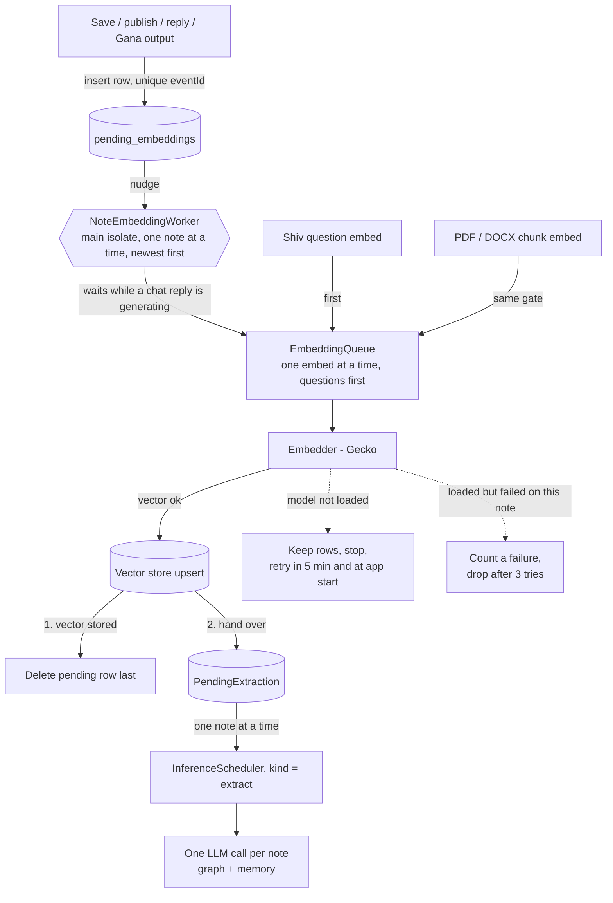

# Embedding — how text becomes a vector

Everything Shiv retrieves is found by similarity between vectors, so the path
from text to vector decides what Shiv can answer. This is how it works today.
Issues: #231 (queue), #125 (batching, not adopted), #232 (store version, not
built), #234 (declared vs real dimension).

## What gets embedded, and when

| Text | Entry point | Priority |
|------|-------------|----------|
| A note the user **saves**, **publishes**, **replies** with, or a **Gana** publishes | `EmbedAndStoreNoteUseCase` → pending table → `NoteEmbeddingWorker` | background |
| A PDF / DOCX / image-text **chunk** | `DocumentIndexer` → `EmbedAndStoreChunkUseCase` | background |
| A Shiv **question** (and Manas context queries) | `EmbeddingService.embed(text)` | interactive |

Feed notes the user only scrolls past, and notes arriving from relays, are not
embedded. A note with fewer than 4 characters after media URLs are stripped is
skipped.

## The pipeline

## The pieces

| Piece | Where | Job |
|-------|-------|-----|
| `PendingEmbeddingModel` / `PendingEmbeddingRepository` | `lib/data/models/`, `lib/data/repositories/` | Notes waiting for a vector. One row per `eventId`, holds the text to embed. Returns `Either<Failure, T>`. |
| `EmbedAndStoreNoteUseCase` | `lib/domain/usecases/vector_usecases.dart` | Strips media URLs, skips text under 4 characters, queues the note, calls the trigger. Never throws. |
| `NoteEmbeddingTrigger` | `lib/domain/services/` | Domain interface (`nudge()`); the worker implements it. |
| `NoteEmbeddingWorker` | `lib/features/shiv/rag/indexing/` | Drains the table. |
| `EmbeddingQueue` | `lib/data/datasources/llm/embedding_queue.dart` | The one gate: one embed in flight, interactive before background. |
| `EmbeddingService` | `lib/features/shiv/rag/embedding/` | Loads Gecko (the 256-token file, the 1024-token file only for text that does not fit), runs every embed through the gate. |
| `NoteVectorStore` | `lib/data/datasources/note_vector_store.dart` | Where a note's vector is kept: the `tostore` store, in its own isolate, behind a message API. Opened at `tostore_<dim>d_v<N>` (#232). |

## Rules

- **A row is deleted only after its vector is stored.** A kill, a crash or a failing store loses nothing; at worst the note is embedded twice.
- **The table only holds notes that still need a vector.** Empty means no work: a pass is one query. There is no polling and no database watcher; the only timer is the 5-minute retry after a failed pass.
- **When it runs:** when a row is added, at app start (`main.dart`), and after the retry timer. It runs only while the app is open; rows wait for the next launch otherwise.
- **One worker, one note at a time, newest first.** A note queued while it runs sets a "go again" flag, so passes never overlap and nothing is stranded.
- **A vector store failure is not the note's fault.** If saving the vector throws (for example the store isolate stopped), the row is kept, the pass stops and it retries later; it is never counted toward the 3-failure drop, so a store outage cannot cost notes their place in the queue.
- **`embed` answers `[]` for two different reasons.** Model not loaded → keep the note, stop, retry later (`EmbeddingService.isReady` is false). Model loaded but no vector for this text → count a failure and drop the note after 3, or one bad note would block the queue forever.
- **A question waits for at most one embed.** When a slot frees, interactive waiters go before queued background ones. The embed already running cannot be interrupted.
- **Chat first.** The worker waits (polls every 2 s) while `InferenceScheduler.isChatRunning`. Gana, extraction and Nataraj jobs do not hold it back.
- **Knowledge extraction is unchanged:** one on-device LLM call per note, scheduled as `extract`, skipped when no model is active, drained when the user is away from Shiv. The worker only feeds it.
- **Always embed through `EmbeddingService.embed`.** A direct call to the model skips the gate.
- **An over-long text is shortened and retried, not truncated by the plugin.** flutter_edge_ai 2.3 throws `EmbeddingInputTooLongException` (with the token limit and the actual count); `EmbeddingService` cuts the text in proportion, with a 10 % margin, and tries again up to 4 times, then gives up with `[]`.

## Deleting a note

Every deletion path calls `purgeNotesInTxn` (`lib/data/datasources/note_purge.dart`) inside its own transaction: the note, its unread and relation rows, its memory summary, its graph edges (a concept stays while another edge uses it), its pending embed/extract rows, and a `PendingVectorDelete` row are handled together. The vector lives in the store's isolate, so `NoteVectorCleanupWorker` removes it from the queue afterwards, row last. On launch it also sweeps vectors that have no note (never when there are no notes at all) and rebuilds the index once per store format. A note that is still saved keeps its vector and knowledge. Never delete `NoteModel` rows directly.

## Why one at a time

Measured on a vivo 1933 (Snapdragon 710), real Gecko model:

- One embed with the 1024-token file costs **~11.5 s**, whatever the text: 4 characters 11.54 s, ~200 chars 11.53 s, ~1,500 chars 11.57 s, ~6,000 chars 11.61 s. The forward pass is compiled for a fixed input (the model name says 1024 tokens) and a batch of 1, so every call processes a full padded input. This is why the app now embeds with the 256-token file wherever the text fits: see [Two Gecko files](#two-gecko-files-266).
- One at a time, two at a time, `generateEmbeddings` in groups of 4 and all at once all took the same ~46.3 s for 4 notes (1.00x). In the plugin `generateEmbeddings` is one request per text to a single worker isolate, so batching saves nothing (#125).
- The model returns 768-dimension vectors (the "1024" in its name is the input length); the app and the note store now declare 768 (#234).

| | Before the queue | After |
|---|---|---|
| One note stored | 12.1 s | 11.8 s |
| Burst of 4 notes saved at once | all four appear together at ~46.5 s | at 12.4, 24.1, 36.1, 47.8 s |
| A Shiv question right after a burst of 4 | answered after 57.9 s | answered after 23.1 s |

A running embed costs a chat reply roughly 10-20 % and the first token almost
nothing (1.58 → 1.65 s), with the chat model on the GPU and the embedder on the
CPU (two alone samples, one contended: indicative only). The GPU backend is not
an option: flutter_edge_ai runs these embedders on the CPU only.

## Two Gecko files (#266)

Gecko comes as several files that differ only in their fixed input length
(`litert-community/Gecko-110m-en` on Hugging Face; both bundled files match it
byte for byte). The app bundles two and picks per text:

- `gecko_256_quant.tflite` (114 MB): the default. Questions, PDF/DOCX chunks
  (at most 700 characters) and most notes fit it.
- `gecko_1024_quant.tflite` (145 MB): only for text the 256 file rejects. Text
  over `EmbeddingService.shortModelMaxChars` (1,200 characters) goes straight
  to it; shorter text that still has more than 256 tokens is rejected by the
  256 file in about 15 ms (no wasted embed) and retried on the 1024 file.
  Text too long even for 1024 is shortened and retried, as before.

The plugin keeps one embedder loaded, so a switch unloads one file and loads the
other. The queue runs one embed at a time, so a switch never closes a model in
use.

Measured on the vivo 1933 (Snapdragon 710), both files from app assets, two
rounds back to back (`integration_test/embedding_variants_e2e_test.dart` keeps
the guard; the measuring tests were removed after this was written down):

| | 256 file | 512 file (not bundled) | 1024 file |
|---|---|---|---|
| One embed, any text that fits | **2.2 s** | 4.9 s | 11.7 s |
| Switch to this file (install + load) | ~1.1 s | | ~1.1 s |
| First install (copies the asset) | ~1.1 s, once | | |
| Fits | ~1,100 characters | ~2,200 | ~4,500 |

- **Same vectors.** For the same text the 256, 512 and 1024 files give the same
  vector (cosine 1.0000, 32 notes and questions). Searching 1024-file note
  vectors with 256-file questions finds the right note first for 15/16 and in
  the top 3 for 16/16, exactly as 1024 with 1024. So nothing stored had to be
  re-embedded, and a mixed index is one vector space.
- **The earlier noisy numbers** (2.1 s against 6.5 s for 256, and 11.8 s for a
  512 run) came from the old measuring test: `ensureInstalled` skipped the
  install whenever any embedder was active, so a run often kept the previous
  file. The new readings were within a few milliseconds across rounds.
- **Through the app** (guard test): a question 2.2 s, a 1,190-character note
  2.2 s, a 3,500-character note 13.1 s (switch plus one 1024 embed), the next
  question 3.4 s (switch back plus one 256 embed).

### Chunking long notes was measured and not done

The issue suggested cutting long notes into chunks so the fast file could take
them. Measured with 14 notes of 950-2,000 characters, 16 short notes in the
same index, and 44 questions (28 aimed at the start or the end of a long note):

| | Long-note questions: first / top 3 | Short-note questions: first / top 3 | One note fills 2+ of the top 3 | Time to index |
|---|---|---|---|---|
| Whole note, 1024 file (today) | 25/28 · 28/28 | 13/16 · 16/16 | 0/44 | 352 s |
| 700-character chunks, 256 file | 27/28 · 28/28 | 12/16 · **15/16** | **32/44** | 109 s |
| 1,800-character chunks, 512 file | 25/28 · 28/28 | 13/16 · 16/16 | 4/44 | 156 s |

Small chunks found parts of long notes better but pushed a short note out of
the top 3 and let one note fill most of the top results, so they change
ranking. Chunking would also have to change the delete queue, the launch sweep
(which would otherwise delete every chunk, since a chunk id is not a note id),
search de-duplication, the small-model cut-off, knowledge extraction and Manas
scoping. Picking the file by length gets the speed without any of that: the
vectors are the ones the 1024 file would have produced. Chunking only pays for
notes over ~4,500 characters (their end is cut today), which are rare.

## Not covered

- Notes saved before the queue existed that never got a vector, and a store format change (#232): both need a cheap "has a vector" check first (a note now costs ~2.2 s on the 256 file, 11.7 s if long).
- A very large PDF/DOCX still keeps the embedder busy for a while, now ~2.2 s a chunk instead of ~11.5 s (a 40-chunk PDF: ~1.5 min instead of ~7.8 min).
- Notes longer than ~4,500 characters are still shortened to fit the 1024 file.

## Tests

- CI: `test/domain/usecases/vector_usecases_test.dart`, `test/data/repositories/pending_embedding_repository_impl_test.dart`, `test/features/shiv/rag/indexing/note_embedding_worker_test.dart`, `test/data/datasources/llm/embedding_queue_test.dart`, `test/features/shiv/rag/embedding/embedding_service_test.dart`, `test/integration/note_embedding_flow_test.dart`, and the note-plus-PDF group in `test/integration/document_rag_flow_test.dart`.
- Device (`integration_test/`, real model): `embedding_variants_e2e_test` (the two files agree; timings through the app), `note_embedding_queue_e2e_test`, `embedding_priority_e2e_test`, `note_save_timing_e2e_test` (runs unchanged on old and new code), `chat_embed_contention_e2e_test`, `embedding_benchmark_test` (run it in profile mode with `flutter drive --driver=test_driver/integration_test.dart --profile`).
